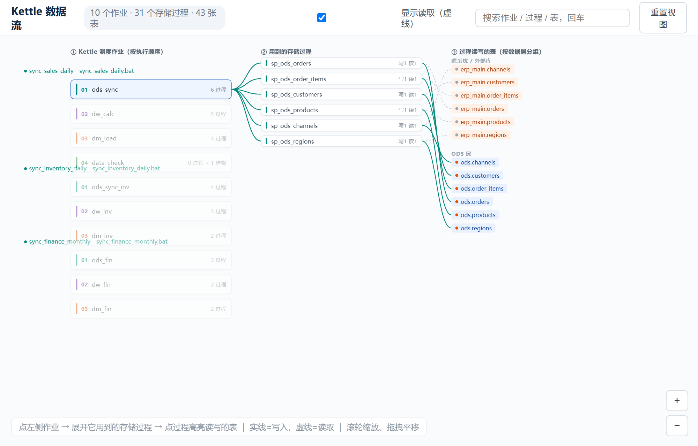
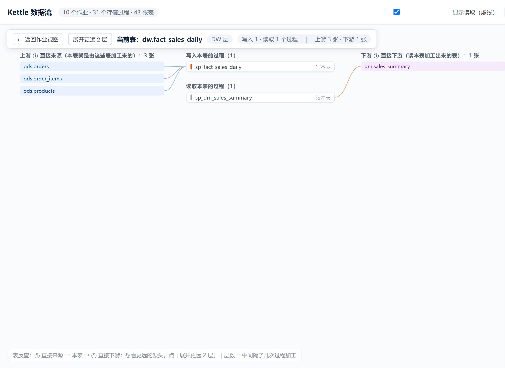
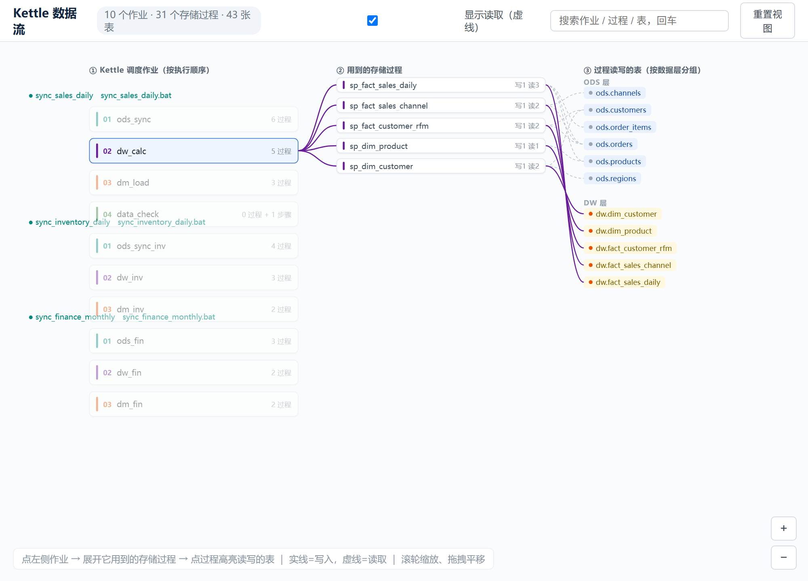

# kettle-lineage

从 Kettle 作业文件与数据库存储过程导出中，还原「调度作业 → 存储过程/SQL 步骤 → 表」三级血缘。

**零配置**：库名自动探测，换任何项目都不用改代码。

- 交互式数据流图（离线 HTML）：点作业看它调了哪些过程，点表看上下游影响
- Excel 台账：作业明细 / 表反查 / 表级血缘 / 作业汇总
- 大纲 txt：Tab 缩进，可直接导入百度脑图、XMind、Obsidian



> **左侧**按 Kettle 真实执行顺序排列调度作业，**中间**是它调用的存储过程，**右侧**是这些过程读写的表（按 源系统 / ODS / DW / DM 分层配色）。
> 实线=写入，虚线=读取。以上截图均来自 [`docs/demo/`](docs/demo/) 的虚构示例数据。

### 点表反查：上游溯源 + 下游影响



> 点任意一张表即可进入反查：左边是「谁供数给它」，中间是「谁写它、谁读它」，右边是「它喂给了谁」。可逐层下钻。

### 一个过程读多张表、写一张表



> 过程节点上标着 `写1 读3` 这类摘要，一眼看出聚合关系；表按数据层分组，ODS 层是被读的原料，DW 层是被写的产物。

**想直接体验**：下载 [`docs/demo/flow.html`](docs/demo/flow.html) 用浏览器打开（纯离线单文件，无需装任何东西）。

## 安装

作为 WorkBuddy / Claude Skill：

```bash
git clone https://github.com/<your-name>/kettle-lineage.git ~/.workbuddy/skills/kettle-lineage
```

或下载 `kettle-lineage.zip` 后在客户端「技能」里导入。

只要 Python 3.8+；导出 Excel 需要 `pandas` 或 `openpyxl`（`pip install openpyxl`）。

## 快速开始

**只需要一条命令**——指向 Kettle 作业所在的目录：

```bash
python scripts/run_all.py --bat-dir "D:/etl/data_sync_new" --outdir output
```

它会自动扫描该目录下所有调度 bat（跳过 bak/copy/test），按 Kettle 真实执行顺序逐层展开，然后输出下面 4 个文件。

### 情况不一样？只换一个参数

| 你的情况 | 怎么改 |
|---|---|
| 目录里有一堆 bat（**最常见**） | 就用上面那条，不用改 |
| 只关心某一个 bat | 把 `--bat-dir "目录"` 换成 `--bat "路径/xxx.bat"`（可重复多次） |
| 有存储过程导出文件 | 加一句 `--dump "路径/过程导出.txt"` —— **强烈建议**，能把血缘挖到表级 |
| 想跳过自检先看效果 | 命令末尾加 `--skip-test` |
| 只要其中某一样产物 | 用文末「进阶：只重跑某一步」 |

有存储过程导出时，完整命令长这样：

```bash
python scripts/run_all.py --dump "D:/etl/procedures.txt" --bat-dir "D:/etl/data_sync_new" --outdir output
```

产物在 `output/`：

| 文件 | 内容 |
|---|---|
| `flow.html` | 交互式数据流图（双击打开，离线可用） |
| `台账.xlsx` | 5 sheet：说明 / 作业明细 / 表反查 / 表级血缘 / 作业汇总 |
| `大纲.txt` | 脑图大纲（`目标表：` / `来源表：` 标注方向） |
| `lineage.json` | 中间数据 |

`run_all.py` 会自动跑自检，**有 FAIL 就中断**，不产出错误数据。

## 输入

| 输入 | 必需 | 说明 |
|---|---|---|
| 调度 `bat` | ✅ | 内含 `Kitchen -file=xxx.kjb`，程序据此定位主作业 |
| `kjb` / `ktr` | ✅ | 与 bat 同级或上下 4 层内；bat 写生产机绝对路径也能按 basename 找到 |
| 存储过程导出 | 可选 | 含多个 `CREATE PROCEDURE/FUNCTION` 全文。没有则 `CALL` 只到过程名，表血缘展不开 |

## 存储过程怎么导出（标准输入）

`--dump` 要的是一份**纯文本文件**，里面是每个存储过程的**完整正文**（不是名字清单）。`.sql` / `.txt` 都行，UTF-8 编码。

**PostgreSQL**

```bash
pg_dump -h 主机 -p 5432 -U 用户名 -d 数据库名 --schema-only -n ods -f procedures.sql
```

**SQL Server**（SSMS 图形界面）：右键数据库 → Tasks → Generate Scripts → 勾选 Stored Procedures → Advanced 里把 `Types of data to script` 设为 **Schema only** → 保存为单个 `.sql`

**MySQL**

```bash
mysqldump -h 主机 -u root -p --routines --no-data --no-create-info 数据库名 > procedures.sql
```

> MySQL 的 `--routines` 不能漏，否则过程根本不导出。

导出后数一下，应该和你库里过程数量对得上：

```bash
grep -cE "CREATE +(OR +REPLACE +)?(PROCEDURE|FUNCTION|PROC) " procedures.sql
```

各家写法都已兼容：`CREATE OR REPLACE`（PG/Oracle）、``CREATE DEFINER=`u`@`h` ``（MySQL）、`CREATE PROCEDURE [dbo].[x]`（SQL Server 自动归一为 `dbo.x`）、`CREATE PROC`；调用侧的 `CALL` / `EXEC` / `EXECUTE` 都认。

📖 **pgAdmin 图形界面步骤、Oracle、导出后自检、常见问题** → [docs/export-procedures.md](docs/export-procedures.md)

## 库名自动探测

不用配置。程序从三处统计库名并互相验证：

1. `.ktr/.kjb` 里 SQL 的 `FROM/JOIN/INTO/UPDATE 库.表`
2. `.ktr` 的 `<schema>xxx</schema>`（Kettle 显式配置，权重最高）
3. `--dump` 过程正文里的 `库.表`

自动排除两类误判：`表.字段`（`order_list.created_time`）、以及"库下全是字段名"的情况。
运行时打印 `[探测] 自动识别库名 N 个: ...` 可直接核对。

只有探测不到才需要 `--schema mydb` / `--allow-bare` / `--no-schema-filter`。

## 进阶：只重跑某一步

**首次使用请忽略这一节**——上面的 `run_all.py` 已经把抽取、自检、出图、出台账串好了。

只有这两种情况才需要分步：

1. **只想调样式 / 改 Excel 表头** → 改完重跑后两步就行，不必重新解析几十 MB 的过程导出
2. **想单独看中间结果** → 直接查 `lineage.json` 里的原始数据

```bash
# ① 抽取（唯一需要 dump + bat 的一步）
python scripts/extract_lineage.py --dump procedures.txt --bat-dir 目录 --out output/lineage.json
# ② 自检（可选）
python scripts/selftest.py       --lineage output/lineage.json --dump procedures.txt
# ③ 出图（改了模板时重跑这个）
python scripts/render_html.py    --in output/lineage.json --out output/flow.html
# ④ 出台账 + 大纲（改了表头时重跑这个）
python scripts/export_reports.py --in output/lineage.json --xlsx output/台账.xlsx --txt output/大纲.txt
```

## 自检

```bash
python scripts/selftest.py --lineage output/lineage.json --dump procedures.txt
```

11 项检查（结构完整性、源码回溯、入口覆盖率、边方向一致性）。
带业务金标准最可靠：

```json
{"dw.fact_daily_summary": ["ods.trade_order_detail"]}
```

```bash
python scripts/selftest.py --lineage output/lineage.json --expect expect.json
```

## 解析规则要点

1. 存储过程**按 SQL 语句级配对**（该语句的 FROM/JOIN → 该语句的写入目标），不能整个过程体「读表 × 写表」，否则是笛卡尔积假血缘
2. `CREATE [TEMP] TABLE ... AS` 计入写入（否则「先建临时表再写目标表」会断链）
3. 临时表先建边再**图收缩**（源→tmp→目标 ⇒ 源→目标）。识别含 `tmp_`/`temp_`/`t_N` 前缀与 `CREATE TEMPORARY TABLE` 显式声明
4. Kettle `TableOutput` 沿 `.ktr` 的 `<order><hop>` 反向回溯到 `TableInput` 取源表
5. 每个内联 SQL 步骤独立成节点，跨作业合并会串线
6. 裸表名归一按「层级优先 + 出现频次」，不按字母序

## 已知局限

- `EXECUTE` 动态拼接 SQL 无法静态解析
- Kettle `${变量}` 表名（按日期分表等）无法静态确定
- 视图按表处理，未展开到基表
- 仅覆盖传进去的那些 bat 链路

## 目录

```
SKILL.md                  触发条件与工作流
scripts/extract_lineage.py  解析引擎（Kettle + 存储过程 → lineage.json）
scripts/selftest.py         自检
scripts/render_html.py      出交互图（用 assets/template.html）
scripts/export_reports.py   出 Excel + 大纲
scripts/run_all.py          一键串联
assets/template.html        前端模板（离线）
references/lineage-rules.md 解析规则、踩坑、验收清单
```

MIT License
